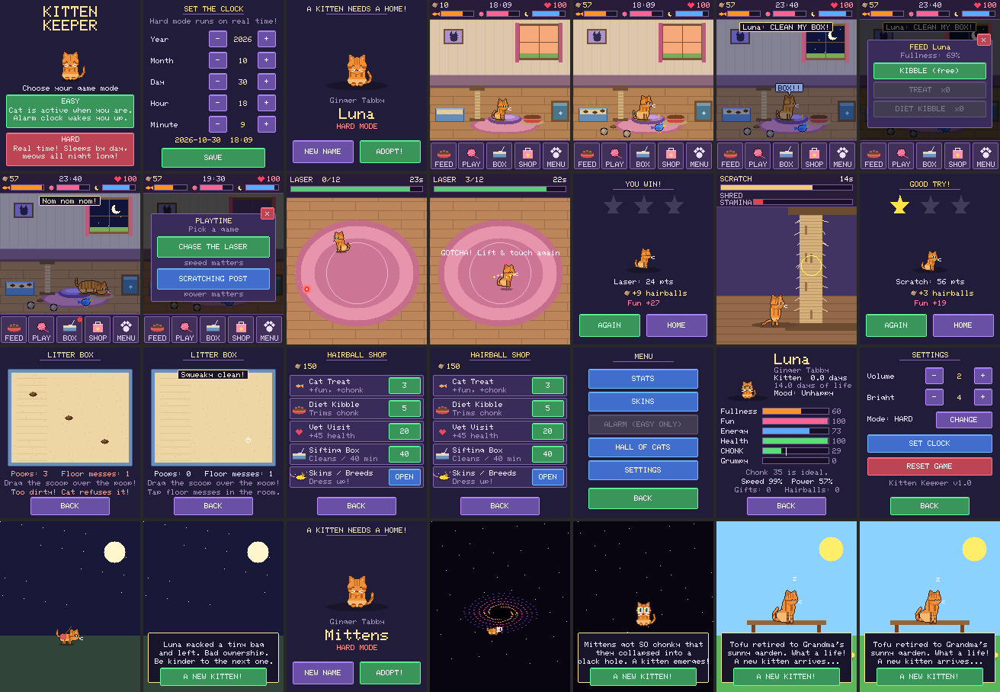

# Kitten Keeper

A Tamagotchi-style cat-raising game for the **Waveshare ESP32-S3-Touch-AMOLED-1.8** (368x448 SH8601 AMOLED, FT3168 touch, QMI8658 IMU, PCF85063 RTC, ES8311 audio).

> **Status:** the game logic, art, balance and save system are exercised by a PC simulator (included).
> The hardware layer (`src/hal/`) was written against Waveshare's reference code and syntax-checked,
> but **has not been run on a real board**. Expect to do a short bring-up pass (see "First boot").

## Build & flash (about 10 minutes the first time)
**Easiest: VS Code + PlatformIO**
1. Install [VS Code](https://code.visualstudio.com/), then the **PlatformIO IDE** extension (Extensions panel, search "PlatformIO").
2. Unzip this project, then *File → Open Folder…* and pick the `cat-tamagotchi` folder. PlatformIO downloads the ESP32
   toolchain on first open (a few minutes, needs internet).
3. Plug the board in over USB-C. Click the **→ (Upload)** arrow in the blue status bar at the bottom. PlatformIO compiles,
   finds the port and flashes. Click the **plug (Serial Monitor)** icon to watch the boot log.
4. If the upload can't find the board: hold **BOOT**, tap **RESET**, release **BOOT**, then upload again.
   No "formatting" is needed; flashing overwrites the app. The game's save lives in NVS and survives re-flashing.

**Command line:** `pip install platformio`, then `pio run -t upload && pio device monitor`.

**Want just a .bin?** Push this folder to a GitHub repo: the included workflow (`.github/workflows/build.yml`) builds
`kitten-keeper-merged.bin`. Flash it at offset `0x0` with the browser flasher at https://espressif.github.io/esptool-js/
(Chrome/Edge, 921600 baud).

## First boot
Serial log (115200) prints `[hal]` / `[audio]` lines. If the screen stays black check `board.h` pins against the Waveshare
schematic; if touch is dead check the I2C address for the FT3168 (`0x38`); if there is no sound check `[audio] ok`.

## How to play
- **Pick a mode** on first start: **Easy** (cat is active whenever you are; it only wakes you if you set an alarm)
  or **Hard** (real clock: cat sleeps by day, runs around, uses the litter and meows at you at night).
- **Home:** tap the cat to pet it, hold to purr. Toolbar: FEED / PLAY / POO / SHOP / MENU.
- **Feed:** kibble, treats, diet food. Overfeeding makes the cat **chonky** (slower, but heavier = stronger in the scratch game).
  Past the limit it collapses into a **black hole** and a new kitten spawns.
- **Laser chase:** your finger is the laser dot. Lead the cat, make it pounce, and avoid exhausting it. Fit cats win more.
- **Scratching post:** swipe up/down in rhythm to keep combos going; stamina and weight matter.
- **Litter box:** tap droppings to scoop. Buy a better box in the shop (auto-clean tiers).
- **Hairballs** and **prey** (mice, birds...) the cat brings home are **currency**; spend them in the shop and on new **breed skins**.
- **Shake or lift the device while the cat sleeps** and it wakes up grumpy (fun down, resentment up).
- **Bad ownership** (hunger, mess, neglect, resentment) makes the cat **run away**. A healthy, well-kept cat lives ~14 days and retires into the Hall.

## Time scale (testing)
Settings -> tap the title 6 times to cycle debug time x1 / x60 / x600 / x3600.

## Project layout
| path | what |
| --- | --- |
| `src/game/` | portable game (no hardware calls): pet model, art, screens, mini-games, save |
| `src/hal/` | board support: display (Arduino_GFX), touch, IMU, RTC, NVS, ES8311 audio synth |
| `src/main.cpp` | `setup()/loop()` |
| `sim/` | PC simulator + tests: `make && ./sim shots <dir> | balance | motion | persist` |

Rendering: a 184x224 RGB565 logical canvas, upscaled 2x in 16-row chunks through a DMA buffer, so no PSRAM is needed.

## Tuning
`src/game/pet.h` / `pet.cpp` hold the rates (hunger, resentment, night budget, ageing, `CHONK_BLACK_HOLE`).
`src/game/breeds.cpp` holds breed speed/gain/hair multipliers and prices. After changing anything run `./sim balance`.

## Licenses
Project code: yours to use. `src/hal/es8311/` is Waveshare's ES8311 driver (Apache-2.0).

## What's in this build
Empty Grimy Cartoon house (baked day/night room + live window), pixel cats (skinny/normal/chonk, 8 breeds), shop with
supplies, furniture, boxes and toys, Catnip Treat (+40 energy), Maze Run, Explore (bushes, caves, hermit), Magic Cat,
scoop-and-tilt litter game, scratching post.  Saves from older versions are discarded automatically (save version 6).

## Boards

| PlatformIO env | Board | Notes |
|---|---|---|
| `amoled18` (default) | Waveshare ESP32-S3-Touch-AMOLED-1.8 | 368x448, the original target |
| `amoled216` | Waveshare ESP32-S3-Touch-AMOLED-2.16 | 480x480 CO5300 + CST9220 touch; the 368x448 game picture is centred on the panel |
| `lcd183` (shelved) | Waveshare ESP32-S3-Touch-LCD-1.83 | Not built by default and no longer maintained (washed-out colours, misplaced touches). `pio run -e lcd183` still builds it |

`pio run -e amoled216 -t upload` builds and flashes the 2.16" version. That port was written from Waveshare's pin
tables and has not been run on real hardware yet: if the picture or the touch is turned or mirrored, see the
`KK_LCD_MADCTL` / `KK_TOUCH_*` flags in `platformio.ini`. The Serial Monitor prints `[touch] panel x,y` for each tap.
