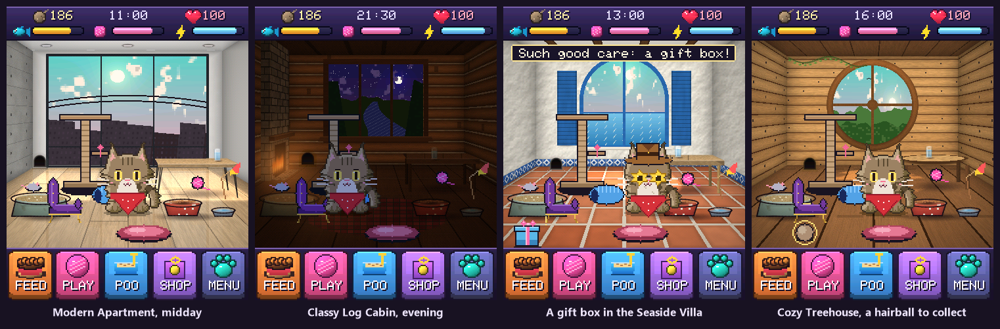
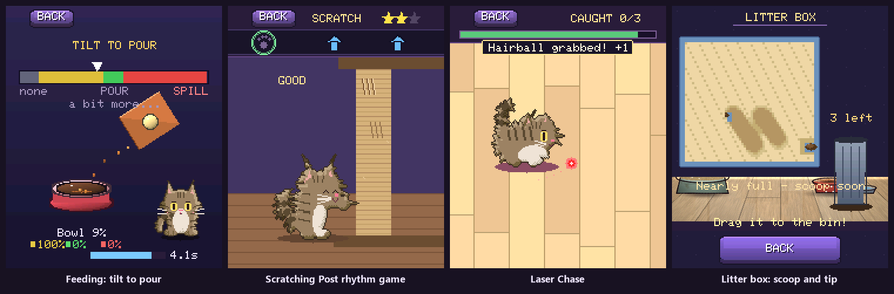
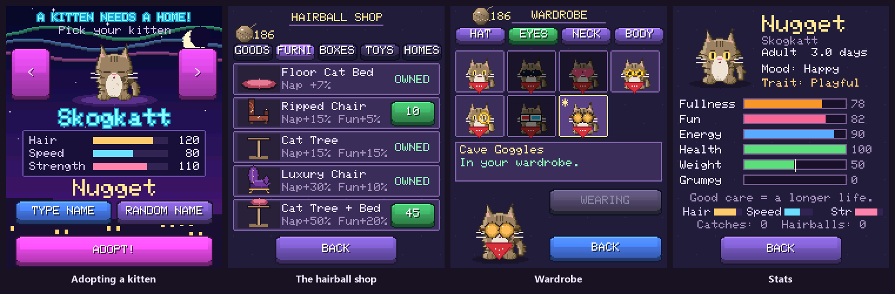
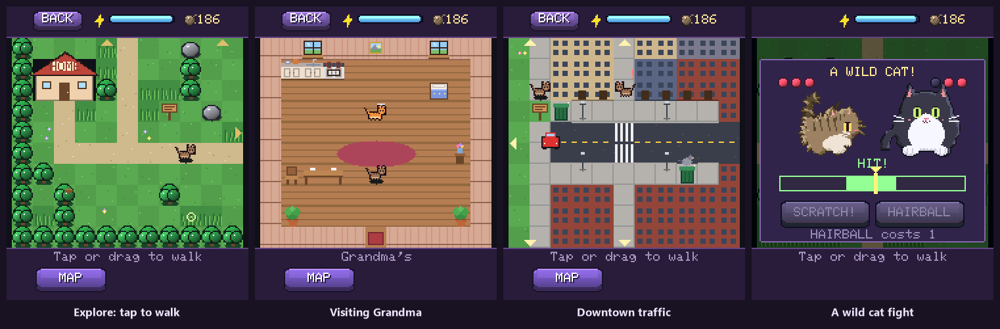

# Kitten Keeper

A Tamagotchi-style virtual pet cat (a "vpet") for the **Waveshare ESP32-S3-Touch-AMOLED-1.8** and **ESP32-S3-Touch-AMOLED-2.16**. Feed it, play with it, keep its litter box clean, dress it up, and watch it grow up over a month of real time.



> **Status:** an experimental hobby project, tested on Waveshare boards only. It is provided as is, with no warranty (see [Licence](#licence)). If something is off on your unit, the Serial Monitor log (115200 baud) shows `[hal]` and `[audio]` lines that say what the hardware did.

## Get it running

**Easiest: flash a release.** Download the `.bin` for your board from the [Releases page](https://github.com/pchrome82/kitten-keeper/releases) and flash it at offset `0x0`, for example with the browser flasher at https://espressif.github.io/esptool-js/ (Chrome or Edge, 921600 baud). If the board isn't found, hold **BOOT**, tap **RESET**, release **BOOT**, then try again. Flashing keeps your save, which lives in the board's NVS.

| Board | File |
|---|---|
| ESP32-S3-Touch-AMOLED-1.8 | `kitten-keeper-<version>-amoled18.bin` |
| ESP32-S3-Touch-AMOLED-2.16 | `kitten-keeper-<version>-amoled216.bin` |

**Build it yourself.** Install [VS Code](https://code.visualstudio.com/) with the PlatformIO IDE extension (or `pip install platformio`), open this folder, and run:

```
pio run -e amoled18  -t upload
pio run -e amoled216 -t upload
pio device monitor
```

A plain `pio run` builds both boards. The first build downloads the ESP32 toolchain (a few minutes). GitHub also builds both firmwares on every push (see `.github/workflows/build.yml`).

**If the picture or touch is turned or mirrored** on a 2.16" board, add `-DKK_LCD_MADCTL=0xA0`, `-DKK_TOUCH_SWAP_XY=1`, `-DKK_TOUCH_MIRROR_X=1` or `-DKK_TOUCH_MIRROR_Y=1` to that board's `build_flags` in `platformio.ini`. The Serial Monitor prints `[touch] panel x,y` for each tap. **Settings → TOUCH FIX** calibrates the touch from five taps and survives a game reset.

## How to play
- **Adopt** a kitten: pick one of seven breeds (Tabby, Siamese, Tuxedo, Void Cat, Calico, Sphynx, Skogkatt), each with its own hair, speed and strength, and name it. Two **secret breeds** (the Rainbow Cat and the Hamster) are unlocked by rare endings and arrive fully grown.
- **Home:** tap the cat to pet it, hold to purr. The toolbar is **FEED / PLAY / POO / SHOP / MENU**; a red dot on a button means that need wants you now.
- **Day and night.** The cat is up and about from 8 am to 8 pm, and Fullness and Fun run on the clock whether you're watching or not: a full meter lasts about 12 hours (about 2 for a kitten). From 8 pm to 8 am the cat naps on screen and both meters creep down slowly. A touch wakes it for a feed or a game, and 15 minutes after your last touch it goes back to sleep. Plan on about three meals and four games a day.
- **Feed:** pour kibble by tilting the device. Overfeeding makes the cat **chonky** (slower, but stronger); starving it makes it skinny. Far enough either way leads to a secret ending.
- **Play:** Laser Chase, Scratching Post, Knock It Off, a maze run, and more. Better scores earn more Fun and **hairballs**.
- **Litter box (POO):** scoop the poops with the finger, carry them to the can and tilt to drop them in.
- **Explore:** once grown up, take your cat on a trip across a map of gardens, the river, caves, downtown and a few secrets. **Tap a spot** and your cat walks there by itself (a quick tap while it's walking stops it), or **hold and drag** to steer; walk off an edge to reach the next screen. Tap things next to your cat to search nests and loose rocks, read signs, open chests and talk to the neighbours, whose houses you can visit. Fish in the river, mind the traffic downtown, and fight wild cats: press **SCRATCH** when the line is on the green (the bar holds for a second to show where you hit) or throw a hairball. Up to four devices can **Explore Together** over a direct radio link (ESP-NOW, no router).

- **Hairballs and prey** the cat brings home are **currency**. Spend them in the shop on supplies, furniture, toys, boxes and **homes**, or on skins and costumes.
- **Wardrobe:** hats, glasses, neckwear and body costumes. Some are bought, some are Explore rewards, and eight are **gift-only**.
- **Gift boxes:** a wrapped box turns up on the cat's birthday, at Halloween, the holidays and New Year, and after five well-cared-for days in a row. Tap it to open it.
- **Shake or lift the device while the cat sleeps** and it wakes up grumpy.
- **Bad ownership** (hunger, mess, neglect, grumpiness) makes the cat **run away**. A well-kept cat lives about a month and retires into the journal.
- **Journal and album:** Menu → JOURNAL keeps milestones and a photo of every cat you have raised at each life stage. The Stats page shows needs, weight, personality and the cat's hair, speed and strength.

## Screenshots
All taken from the real game code running in the PC simulator (`sim/`), at the device's full 368x448 resolution.







## Tuning
`src/game/pet.h` and `pet.cpp` hold the rates: the day and night drain (`DAY_EMPTY_HOURS`, `DAY_EMPTY_HOURS_KITTEN`, `DAY_START`, `DAY_END`, `NIGHT_AWAKE_SECS`), how much weight play burns (`EXERCISE_WEIGHT_LOSS`), ageing and `CHONK_BLACK_HOLE`. `src/game/breeds.cpp` has the breed stats and prices. After changing anything, run the simulator's `balance` test (below).

## Project layout
| path | what |
| --- | --- |
| `src/game/` | the portable game (no hardware calls): pet model, art, screens, mini-games, save |
| `src/hal/` | board support: display (Arduino_GFX), touch, IMU, RTC, NVS, ES8311 audio synth |
| `src/main.cpp` | `setup()` and `loop()` |
| `sim/` | PC simulator and tests; also the room painter that bakes the homes |
| `art/` | the cat sprite generators (Python) and `fluffsit.cpp`, which redraws the Skogkatt's front-facing frames |
| `web/` | a WebAssembly build that runs the real game in a browser |

**Simulator** (needs a C++17 compiler such as g++): `cd sim && make && ./sim balance` runs simulated owners at different care levels, and `./sim motion`, `./sim persist` and `./sim shots <dir>` run the other checks. `make bakeroom && ./bakeroom ../src/game/roomdata.cpp` re-bakes the homes after changing `sim/roomstyles.cpp`.

**Art:** `python art/bake.py src/game` (needs numpy and Pillow) regenerates `catsprites_data.cpp` from the sprite painters; then run `art/fluffsit.cpp` again to restore the Skogkatt's front-facing frames (its build line is in the file's header).

Rendering: a 184x224 RGB565 logical canvas, upscaled 2x in 16-row strips through a DMA buffer over a hi-res room picture, so no PSRAM is needed for the canvas.

## Licence
Kitten Keeper is free for personal, hobby and other noncommercial use under the [PolyForm Noncommercial License 1.0.0](LICENSE). It is provided as is, with no warranty: it has only been tested on Waveshare ESP32-S3 touch boards, and nothing is guaranteed to work on anything else. Want to use it commercially? Open an issue to ask.

`src/hal/es8311/` is Waveshare's ES8311 driver (Apache-2.0) and keeps its own licence.